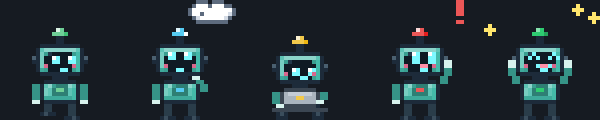
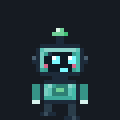
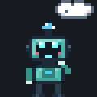
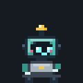
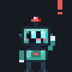
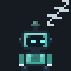
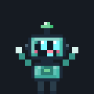
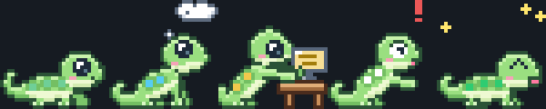
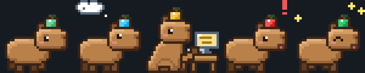

<h1 align="center">🤖 Bit · Claude Pet</h1>

<p align="center">
  <strong>A tiny pixel robot that lives on the edges of your screen and shows what <a href="https://claude.com/claude-code">Claude Code</a> is doing.</strong><br>
  Stop alt-tabbing to the terminal to check if it's done. Just glance at Bit.
</p>

<p align="center">
  <strong>🇺🇸 English</strong> ·
  <a href="README.pt-BR.md">🇧🇷 Português</a>
</p>

<p align="center">
  
  
  
  
  
</p>

<p align="center">
  
</p>

---

## 💡 Why use it

You send a prompt, Claude Code starts working, and you go do something else. Then the loop starts:

- 👀 Switch to the terminal to see if it finished
- ⏳ It's still thinking, so you switch back
- 🙋 Meanwhile it was **waiting for your permission** for 10 minutes
- 🔁 Repeat, all day long

✨ **Bit fixes that.** He walks around the edges of your screen and his animation (and antenna color) tells you the status at a glance:

| | State | What Bit does |
|---|---|---|
|  | **Idle** | Strolls along the floor, walls and ceiling. Sits down, blinks, falls asleep after a while |
|  | **Thinking** (right after your prompt) | Hand on chin, thought cloud above his head 🔵 |
|  | **Working** (running a tool) | Sits down and types on his tiny laptop 🟡 |
|  | **Needs you** (permission request) | Jumps, waves and shows a speech bubble with what Claude wants 🔴 |
|  | **Done** | Celebrates, then waits with a ✓ until you hover or click him 🟢 |
|  | **Sleeping** | No activity for 3 minutes: zzz |
|  | **Grabbed** | Dangles and swings like a pendulum while you drag him around |

> **Your terminal doesn't need to be on screen anymore. Bit is.**

### 🐾 Pick your pet

Not into robots? Right click → **Character**. Every character does everything Bit does (walking on the ceiling, thinking, typing, asking for you, celebrating, sleeping, swinging when dragged) and shows the status through the color of one detail:

| | Character | Where the status "light" is |
|---|---|---|
|  | **Bit**, the robot | Antenna |
|  | **Lagartixa** (gecko), born to walk on walls | Spots on its back |
|  | **Gosminha** (slime), jelly hops | Bubble inside the goo |
|  | **Capivara** (capybara), zen until Claude needs you | Fruit on its head |

---

## ✨ Features

| | |
|---|---|
| 🎯 **Live status** | Driven by Claude Code hooks: prompt, tool use, permission requests, stop |
| 🖱️ **Click to jump back** | When Bit is asking for you or done, one click brings the right terminal window to the front |
| 💬 **Speech bubbles** | Short pixel-art bubbles (in Brazilian Portuguese for now): *"Claude Code terminou. Clique em mim para abrir"* |
| 🧮 **Many chats at once** | Bit shows the most urgent one; hover him for a one-line summary (*"Bit: 1 chat trabalhando, 2 chats de boa"*) |
| 🧗 **Walks everywhere** | Floor, walls and ceiling of your monitor, respecting the dock and top bar |
| 🤹 **Physics** | Drag and throw him, he falls back to the floor. Swings like a pendulum while held |
| 💤 **Moods** | Notices your cursor, enjoys being petted ❤, sleeps when nothing is happening |
| 👻 **Never in the way** | Clicks go through everything except Bit himself. Hide him for 30 min or 2 h from the menu |
| 🧹 **Self-cleaning** | Sessions whose `claude` process died are forgotten automatically |
| 🪶 **Lightweight** | Standard library + the GTK that already ships with your desktop. Redraws only when the frame changes |

---

## 📦 Installation

### ⚡ Quick way (one line)

```bash
mkdir -p ~/.local/share && curl -fsSL https://github.com/krugerrgabriel/claude-pet/releases/latest/download/claude-pet.tar.gz | tar xz -C ~/.local/share && python3 ~/.local/share/claude-pet/install.py && ~/.local/bin/claude-pet &
```

Downloads the latest [release](https://github.com/krugerrgabriel/claude-pet/releases/latest) into `~/.local/share/claude-pet`, installs the hooks and the launcher, and starts the pet. **To update, run the same command** (then quit the pet from its menu and run `claude-pet` again). To remove it: `python3 ~/.local/share/claude-pet/install.py --uninstall`.

### 🛠️ Or from source

### 1️⃣ Clone the repository

```bash
git clone https://github.com/krugerrgabriel/claude-pet.git
cd claude-pet
```

### 2️⃣ Run the installer

```bash
python3 install.py
```

It adds Bit's hooks to `~/.claude/settings.json` (backing it up first and keeping your other hooks untouched), creates the `claude-pet` command and starts Bit automatically when you log in.

### 3️⃣ Start Bit

```bash
claude-pet &
```

Done. 🎉 Open a new Claude Code session and watch him go.

> 💡 **Restart your open Claude Code sessions**: hooks are only read when a session starts.

> 💡 **Prerequisites:** Linux on **X11** (tested on Ubuntu/GNOME) with `python3-gi` and `python3-gi-cairo`, which most desktops already have. `wmctrl` is optional and enables click-to-focus: `sudo apt install wmctrl`.

---

## 🖱️ Interacting with Bit

| Action | What happens |
|---|---|
| **Click** (when he's asking for you or done) | Focuses the terminal of that session and clears the ✓ |
| **Click** (any other time) | He gets happy |
| **Hover** | One-line status: *"Bit está trabalhando (Bash)"* |
| **Hover** (even a quick pass) over the pet or the bubble, when done | Dismisses the "done" bubble and the ✓ (a click right after still opens the terminal) |
| **Hover and wait** | Petting ❤ |
| **Drag and release** | Pick him up, swing him around, throw him |
| **Right click** | List of chats (click one to focus it), **character**, **rename**, **language** (automatic, Portuguese or English), **put to sleep** (sleeps until your next prompt or a permission request), hide for 30 min / 2 h, quit |

---

## ⚙️ Advanced configuration

Only if you want to: everything works out of the box.

<details>
<summary><strong>Tweak Bit (<code>~/.config/claude-pet/config.json</code>)</strong></summary>

```json
{
  "skin": "robo",
  "pet_name": "",
  "language": "auto",
  "scale": 3,
  "body_color": "#5ec4b6",
  "walk_speed": 45,
  "climb_chance": 0.25,
  "sleep_after": 180,
  "done_linger": 900,
  "monitor": -1
}
```

| Key | Meaning |
|---|---|
| `skin` | Character: `robo`, `lagartixa`, `gosminha` or `capivara` (the menu saves it here) |
| `pet_name` | Name used in the bubbles (empty = "Your pet"; the **Rename…** menu item saves it here) |
| `language` | `auto` (follows the system language), `pt` or `en`; the **Language** menu saves it here |
| `scale` | Size of each sprite pixel (3 ≈ 60 px tall) |
| `body_color` | Any color for Bit's body (robot only) |
| `walk_speed` | Pixels per second |
| `climb_chance` | How often he climbs walls and the ceiling (0 = never) |
| `sleep_after` | Seconds without activity before he naps |
| `done_linger` | Seconds the "done ✓" stays if you don't click him |
| `work_hold` | Minimum seconds he stays "working" after a tool runs, so he doesn't flicker between thinking and working (default 5) |
| `monitor` | Monitor index, `-1` = primary |

All keys are optional. Restart Bit after editing.
</details>

<details>
<summary><strong>Uninstall</strong></summary>

```bash
python3 install.py --uninstall
```

Removes only Bit's hooks (backing up `settings.json` first), the `claude-pet` command and the autostart entry.
</details>

---

## 🏗️ How it works under the hood

```
┌──────────────────┐   hook (JSON on stdin)   ┌──────────────────────────────┐
│   Claude Code    │ ───────────────────────▶ │  hooks/claude_pet_hook.py    │
│  (every session) │  prompt · tool · stop …  │  stdlib only, never fails    │
└──────────────────┘                          └──────────────┬───────────────┘
                                                             │ writes
                                                             ▼
                                   ~/.cache/claude-pet/sessions/<session>.json
                                                             │ read every 250 ms
                                                             ▼
┌────────────────────────────────────────────────────────────────────────────┐
│ claude_pet/                                                                │
│   state.py      sums up all sessions, timeouts, priority                   │
│   character.py  movement, physics, pendulum, state machine (no GTK)        │
│   sprites.py    Bit drawn pixel by pixel, all animations                   │
│   window.py     transparent always-on-top GTK window, bubble, menu         │
│   focus.py      brings the session's terminal to the front (wmctrl)        │
└────────────────────────────────────────────────────────────────────────────┘
```

| Claude Code event | Bit |
|---|---|
| `SessionStart` | idle |
| `UserPromptSubmit` | thinking |
| `PreToolUse` / `PostToolUse` | working / thinking |
| `Notification` (permission) | needs you |
| `Stop` | done |
| `SessionEnd` | forgets the session |

### Stack

| Layer | Tech | Why |
|---|---|---|
| **Hook** | Python 3 (stdlib) | Fast, can't break Claude Code, silent on stdout |
| **Window** | GTK 3 + Cairo (PyGObject) | Transparent, click-through, already on your desktop |
| **Art** | Pixel art drawn in code | Every pose is built from parts, so arms and legs really move |
| **State** | One JSON file per session | Easy to inspect, no daemon, no socket |

### Repository layout

```
claude-pet/
├── claude_pet/          ← the pet (python3 -m claude_pet)
│   └── chars/           ← gecko, slime, capybara (one file each)
├── hooks/               ← the Claude Code hook
├── tests/               ← hook → state → behavior
├── tools/               ← sprite previews, review page, README GIFs
├── docs/                ← GIFs used here
├── install.py           ← installer / uninstaller
└── README.md            ← you are here
```

---

## 🔒 Privacy

- Everything stays on your machine. **No network calls.**
- The hook stores only the session status, the tool name, the working directory and the `claude` process id. **Never your prompts or code.**
- The installer backs up `settings.json` before touching it and only adds or removes Bit's own entries.

---

## 🛠️ Developing

```bash
python3 -m unittest discover tests            # hook → state → behavior
python3 tools/review_html.py                  # art/review.html: every animation, frame by frame
python3 tools/make_gifs.py                    # regenerate the GIFs in docs/
CLAUDE_PET_DEBUG=1 python3 -m claude_pet      # logs status and position to stderr
CLAUDE_PET_HOME=/tmp/x python3 -m claude_pet  # isolated state folder for experiments
```

---

## 🐛 Troubleshooting

<details>
<summary><strong>Bit doesn't show up</strong></summary>

Check your session type:

```bash
echo $XDG_SESSION_TYPE
```

Bit needs **X11**. On Wayland, GNOME doesn't let windows place themselves, so Bit can't walk around. Choose "Ubuntu on Xorg" on the login screen.
</details>

<details>
<summary><strong>Bit never leaves "idle"</strong></summary>

- Restart your Claude Code sessions: hooks are loaded when a session starts.
- Check that the hooks are there: `grep claude_pet_hook ~/.claude/settings.json`
- Check that state files are being written: `ls ~/.cache/claude-pet/sessions/`
</details>

<details>
<summary><strong>Clicking Bit doesn't focus my terminal</strong></summary>

Install `wmctrl`: `sudo apt install wmctrl`. Terminals with tabs focus the window, not the exact tab.
</details>

<details>
<summary><strong>"claude-pet já está rodando" (already running)</strong></summary>

Only one Bit at a time. Quit the current one from the right-click menu, or `pkill -f "python3 -m claude_pet"`.
</details>

---

## 📜 License

MIT, do whatever you want.

---

<p align="center">
  Made with Claude Code, watched over by Bit. 🤖
</p>
