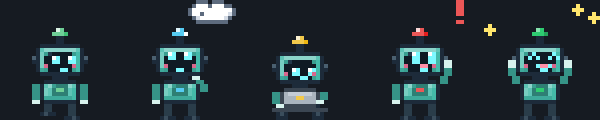
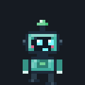
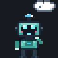
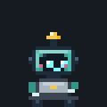
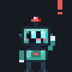
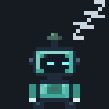
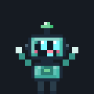
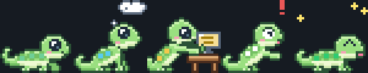
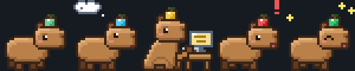

<h1 align="center">🤖 Bit · Claude Pet</h1>

<p align="center">
  <strong>Um robozinho de pixel que mora nas bordas da sua tela e mostra o que o <a href="https://claude.com/claude-code">Claude Code</a> está fazendo.</strong><br>
  Pare de trocar de janela pra ver se o terminal terminou. É só olhar pro Bit.
</p>

<p align="center">
  <a href="README.md">🇺🇸 English</a> ·
  <strong>🇧🇷 Português</strong>
</p>

<p align="center">
  
  
  
  
  
</p>

<p align="center">
  
</p>

---

## 💡 Por que usar

Você manda o prompt, o Claude Code começa a trabalhar e você vai fazer outra coisa. Aí começa o ciclo:

- 👀 Troca pro terminal pra ver se terminou
- ⏳ Ainda está pensando, você volta
- 🙋 Enquanto isso ele estava **esperando sua permissão** há 10 minutos
- 🔁 Repete, o dia inteiro

✨ **O Bit resolve isso.** Ele anda pelas bordas da tela, e a animação (e a cor da antena) mostra o status de relance:

| | Estado | O que o Bit faz |
|---|---|---|
|  | **De boa** | Passeia pelo chão, paredes e teto. Senta, pisca, cochila depois de um tempo |
|  | **Pensando** (logo depois do seu prompt) | Mão no queixo, nuvem de pensamento em cima da cabeça 🔵 |
|  | **Trabalhando** (rodando uma ferramenta) | Senta e digita no notebookzinho 🟡 |
|  | **Precisa de você** (pedido de permissão) | Pula, acena e mostra um balão com o que o Claude quer 🔴 |
|  | **Terminou** | Comemora e fica esperando com um ✓ até você passar o mouse ou clicar nele 🟢 |
|  | **Dormindo** | 3 minutos sem atividade: zzz |
|  | **Agarrado** | Fica pendurado e balança como um pêndulo enquanto você arrasta |

> **Seu terminal não precisa mais estar na tela. O Bit está.**

### 🐾 Escolha seu bichinho

Não curtiu robô? Botão direito → **Personagem**. Todos fazem tudo que o Bit faz (andar no teto, pensar, digitar, pedir atenção, comemorar, dormir, balançar no arraste) e mostram o status pela cor de um detalhe:

| | Personagem | Onde fica a "luzinha" do status |
|---|---|---|
|  | **Bit**, o robô | Antena |
|  | **Lagartixa**, a que mais combina com andar na parede | Pintinhas nas costas |
|  | **Gosminha**, pulinhos de gelatina | Bolhinha dentro da gosma |
|  | **Capivara**, zen até o Claude precisar de você | Frutinha na cabeça |

---

## ✨ Recursos

| | |
|---|---|
| 🎯 **Status ao vivo** | Vem dos hooks do Claude Code: prompt, ferramentas, pedidos de permissão, fim |
| 🖱️ **Clique pra voltar** | Quando ele pede algo ou termina, um clique traz a janela do terminal certo pra frente |
| 💬 **Balões de fala** | Balõezinhos em pixel art: *"Claude Code terminou. Clique em mim para abrir"* |
| 🧮 **Vários chats** | Mostra o mais urgente; passando o mouse, um resumo em uma linha (*"Bit: 1 chat trabalhando, 2 chats de boa"*) |
| 🧗 **Anda por tudo** | Chão, paredes e teto do monitor, respeitando a dock e a barra do topo |
| 🤹 **Física** | Arraste e arremesse, ele cai de volta no chão. Balança como pêndulo enquanto você segura |
| 💤 **Humores** | Repara no seu cursor, gosta de carinho ❤, dorme quando nada está acontecendo |
| 👻 **Nunca atrapalha** | O clique atravessa tudo menos o próprio Bit. Dá pra esconder por 30 min ou 2 h no menu |
| 🧹 **Se limpa sozinho** | Sessões cujo processo `claude` morreu são esquecidas automaticamente |
| 🪶 **Leve** | Biblioteca padrão + o GTK que já vem no seu desktop. Só redesenha quando o quadro muda |

---

## 📦 Instalação

### 1️⃣ Clone o repositório

```bash
git clone https://github.com/krugerrgabriel/claude-pet.git
cd claude-pet
```

### 2️⃣ Rode o instalador

```bash
python3 install.py
```

Ele adiciona os hooks do Bit no `~/.claude/settings.json` (fazendo backup antes e sem mexer nos seus outros hooks), cria o comando `claude-pet` e faz o Bit abrir sozinho quando você faz login.

### 3️⃣ Chame o Bit

```bash
claude-pet &
```

Pronto. 🎉 Abra uma sessão nova do Claude Code e veja ele em ação.

> 💡 **Reinicie as sessões do Claude Code que já estavam abertas**: os hooks só são lidos quando a sessão começa.

> 💡 **Pré-requisitos:** Linux com **X11** (testado no Ubuntu/GNOME), com `python3-gi` e `python3-gi-cairo`, que a maioria dos desktops já tem. O `wmctrl` é opcional e habilita o clique pra focar o terminal: `sudo apt install wmctrl`.

---

## 🖱️ Interagindo com o Bit

| Ação | O que acontece |
|---|---|
| **Clique** (quando ele pede algo ou terminou) | Foca o terminal daquela sessão e limpa o ✓ |
| **Clique** (em qualquer outro momento) | Ele fica feliz |
| **Passar o mouse** | Status em uma linha: *"Bit está trabalhando (Bash)"* |
| **Passar o mouse** (mesmo rapidinho) pelo bichinho ou pelo balão, quando terminou | Dispensa o balão de "terminou" e o ✓ (um clique logo depois ainda abre o terminal) |
| **Deixar o mouse parado em cima** | Carinho ❤ |
| **Arrastar e soltar** | Pega ele, balança, arremessa |
| **Botão direito** | Lista de chats (clique pra focar), **Personagem**, **Mudar nome…**, **Idioma** (automático, português ou inglês), **Botar pra dormir** (dorme até o seu próximo prompt ou um pedido de permissão), esconder por 30 min / 2 h, sair |

---

## ⚙️ Configuração avançada

Só se quiser: tudo funciona sem configurar nada.

<details>
<summary><strong>Ajustar o Bit (<code>~/.config/claude-pet/config.json</code>)</strong></summary>

```json
{
  "skin": "robo",
  "pet_name": "",
  "language": "auto",
  "scale": 3,
  "body_color": "#5ec4b6",
  "walk_speed": 45,
  "climb_chance": 0.25,
  "sleep_after": 180,
  "done_linger": 900,
  "monitor": -1
}
```

| Chave | Significado |
|---|---|
| `skin` | Personagem: `robo`, `lagartixa`, `gosminha` ou `capivara` (o menu grava aqui) |
| `pet_name` | Nome usado nos balões (vazio = "Seu pet"; o menu **Mudar nome…** grava aqui) |
| `language` | `auto` (segue o idioma do sistema), `pt` ou `en`; o menu **Idioma** grava aqui |
| `scale` | Tamanho de cada pixel do sprite (3 ≈ 60 px de altura) |
| `body_color` | Qualquer cor pro corpo do Bit (só o robô) |
| `walk_speed` | Pixels por segundo |
| `climb_chance` | Frequência com que ele sobe paredes e teto (0 = nunca) |
| `sleep_after` | Segundos sem atividade até ele cochilar |
| `done_linger` | Segundos que o "terminou ✓" fica se você não clicar |
| `work_hold` | Segundos mínimos em "trabalhando" depois de uma ferramenta, pra não ficar piscando entre pensar e trabalhar (padrão 5) |
| `monitor` | Índice do monitor, `-1` = principal |

Todas as chaves são opcionais. Reinicie o Bit depois de editar.
</details>

<details>
<summary><strong>Desinstalar</strong></summary>

```bash
python3 install.py --uninstall
```

Remove só os hooks do Bit (com backup do `settings.json` antes), o comando `claude-pet` e a entrada de autostart.
</details>

---

## 🏗️ Como funciona por dentro

```
┌──────────────────┐   hook (JSON no stdin)   ┌──────────────────────────────┐
│   Claude Code    │ ───────────────────────▶ │  hooks/claude_pet_hook.py    │
│  (cada sessão)   │  prompt · tool · stop …  │  só stdlib, nunca falha      │
└──────────────────┘                          └──────────────┬───────────────┘
                                                             │ grava
                                                             ▼
                                   ~/.cache/claude-pet/sessions/<sessão>.json
                                                             │ lido a cada 250 ms
                                                             ▼
┌────────────────────────────────────────────────────────────────────────────┐
│ claude_pet/                                                                │
│   state.py      resume todas as sessões, timeouts, prioridade              │
│   character.py  movimento, física, pêndulo, máquina de estados (sem GTK)   │
│   sprites.py    o Bit desenhado pixel a pixel, todas as animações          │
│   window.py     janela GTK transparente sempre por cima, balão, menu       │
│   focus.py      traz o terminal da sessão pra frente (wmctrl)              │
└────────────────────────────────────────────────────────────────────────────┘
```

| Evento do Claude Code | Bit |
|---|---|
| `SessionStart` | de boa |
| `UserPromptSubmit` | pensando |
| `PreToolUse` / `PostToolUse` | trabalhando / pensando |
| `Notification` (permissão) | precisa de você |
| `Stop` | terminou |
| `SessionEnd` | esquece a sessão |

### Stack

| Camada | Tecnologia | Por quê |
|---|---|---|
| **Hook** | Python 3 (stdlib) | Rápido, não quebra o Claude Code, silencioso no stdout |
| **Janela** | GTK 3 + Cairo (PyGObject) | Transparente, clique atravessa, já vem no seu desktop |
| **Arte** | Pixel art desenhado em código | Cada pose é montada por partes, então braços e pernas se mexem de verdade |
| **Estado** | Um JSON por sessão | Fácil de inspecionar, sem daemon, sem socket |

### Estrutura do repositório

```
claude-pet/
├── claude_pet/          ← o pet (python3 -m claude_pet)
│   └── chars/           ← lagartixa, gosminha, capivara (um arquivo cada)
├── hooks/               ← o hook do Claude Code
├── tests/               ← hook → estado → comportamento
├── tools/               ← prévias dos sprites, página de revisão, GIFs do README
├── docs/                ← GIFs usados aqui
├── install.py           ← instalador / desinstalador
└── README.pt-BR.md      ← você está aqui
```

---

## 🔒 Privacidade

- Tudo fica na sua máquina. **Nenhuma chamada de rede.**
- O hook guarda só o status da sessão, o nome da ferramenta, a pasta de trabalho e o PID do `claude`. **Nunca seus prompts ou seu código.**
- O instalador faz backup do `settings.json` antes de mexer e só adiciona ou remove as entradas do próprio Bit.

---

## 🛠️ Desenvolvendo

```bash
python3 -m unittest discover tests            # hook → estado → comportamento
python3 tools/review_html.py                  # art/review.html: todas as animações, quadro a quadro
python3 tools/make_gifs.py                    # regera os GIFs de docs/
CLAUDE_PET_DEBUG=1 python3 -m claude_pet      # log de status e posição no stderr
CLAUDE_PET_HOME=/tmp/x python3 -m claude_pet  # pasta de estado isolada pra experimentar
```

---

## 🐛 Solução de problemas

<details>
<summary><strong>O Bit não aparece</strong></summary>

Veja o tipo de sessão:

```bash
echo $XDG_SESSION_TYPE
```

O Bit precisa de **X11**. No Wayland, o GNOME não deixa a janela se posicionar sozinha, então ele não consegue andar. Escolha "Ubuntu on Xorg" na tela de login.
</details>

<details>
<summary><strong>O Bit nunca sai do "de boa"</strong></summary>

- Reinicie as sessões do Claude Code: os hooks são carregados quando a sessão começa.
- Confira se os hooks estão lá: `grep claude_pet_hook ~/.claude/settings.json`
- Confira se os arquivos de estado estão sendo gravados: `ls ~/.cache/claude-pet/sessions/`
</details>

<details>
<summary><strong>Clicar no Bit não foca o terminal</strong></summary>

Instale o `wmctrl`: `sudo apt install wmctrl`. Em terminais com abas, ele foca a janela, não a aba exata.
</details>

<details>
<summary><strong>"claude-pet já está rodando"</strong></summary>

Só um Bit por vez. Feche o atual pelo menu do botão direito, ou `pkill -f "python3 -m claude_pet"`.
</details>

---

## 📜 Licença

MIT, faça o que quiser.

---

<p align="center">
  Feito com Claude Code, sob a supervisão do Bit. 🤖
</p>
